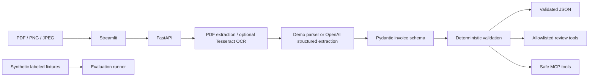

# InvoiceIQ

InvoiceIQ is a local invoice extraction and validation prototype. It reads digital PDF text directly, routes scanned PDFs and images to Tesseract OCR when installed, extracts structured fields using a configured OpenAI model or a clearly labelled local demo parser, and runs financial checks in deterministic Python.

It is an assistive review tool. It does not approve invoices, initiate payments, change extracted amounts, or provide accounting/tax advice.

## Architecture



## Features

- `POST /extract`: supported file validation, size limit, multi-page digital PDF extraction, optional OCR, structured invoice data, validation and processing metadata.
- `POST /validate`: independently validates a structured invoice.
- `GET /health`, `GET /evaluation/summary`, and `POST /review`.
- Pydantic models, field extraction state, line items, and structured validation outcomes.
- Demo parser for offline operation, with no provider calls; OpenAI Responses API structured extraction when explicitly configured.
- 46 synthetic text fixtures (30 legacy and 16 customer-generalization cases) and a reproducible comparison between baseline and improved deterministic parser configurations.
- Allowlisted review helpers and three MCP tools over stdio.
- Streamlit processing, evaluation, and limitations pages calling the FastAPI backend.

## Quick start (Windows PowerShell)

Python 3.11+ is recommended. The workspace was inspected with Python 3.13.5.

```powershell
cd "C:\Users\sarth\Documents\ChatGPT\project kema"
py -3.13 -m venv .venv
.\.venv\Scripts\Activate.ps1
python -m pip install --upgrade pip
pip install -r requirements.txt
Copy-Item .env.example .env
python -m invoiceiq
```

In a second PowerShell window:

```powershell
cd "C:\Users\sarth\Documents\ChatGPT\project kema"
.\.venv\Scripts\Activate.ps1
streamlit run frontend/streamlit_app.py
```

FastAPI docs: [http://127.0.0.1:8000/docs](http://127.0.0.1:8000/docs). Streamlit: [http://localhost:8501](http://localhost:8501).

### Demo mode

`.env.example` defaults to `INVOICEIQ_DEMO_MODE=true`; it runs without credentials. The local deterministic parser recognizes common labelled variants for supplier/customer, invoice identifiers and dates, currency, subtotal, VAT/tax, discount, totals, and simple item tables. It accepts ISO and named-month dates, and leaves ambiguous numeric dates or conflicting labelled values uncertain for human review. This heuristic parser is not an LLM or a general-purpose invoice understanding model; unusual layouts still require review or live extraction.

### OpenAI configuration

Live extraction is opt-in and requires an OpenAI API key with API billing/model access. A ChatGPT subscription alone is not an API key. The app calls `client.responses.parse(...)` only when `OPENAI_API_KEY` is present and `INVOICEIQ_DEMO_MODE=false`; otherwise it uses the local demo parser. `load_dotenv()` does not override variables already set in the process environment, so inherited shell variables take precedence over `.env`.

To prepare the local configuration in PowerShell, copy the example once and edit it locally:

```powershell
Copy-Item .env.example .env
notepad .env
```

Set these values in the ignored `.env` file; enter the key only in that local file (never in source, a commit, chat, or a command line):

```dotenv
OPENAI_API_KEY=your-key
OPENAI_MODEL=gpt-4o-mini
INVOICEIQ_DEMO_MODE=false
```

Restart the backend after editing configuration; settings are cached for the life of the process. Check `GET /health`: it should report `mode: live` and the configured model before uploading anything. A real `/extract` or live `/review` request sends document-derived text to the OpenAI API and may incur charges. No request is made just by starting the app or opening `/health`; this project has not made a live provider request as part of its local tests. Do not send sensitive documents unless authorized and you understand provider data handling. Provider errors surface as errors; the app does not silently downgrade to demo output.

To return to offline demo mode, set `INVOICEIQ_DEMO_MODE=true` in `.env`, restart the backend, and confirm `GET /health` reports `mode: demo`. You can also remove the key from `.env`; the file remains ignored by Git. For a predictable mode, close shells that may have conflicting inherited `INVOICEIQ_DEMO_MODE` or `OPENAI_API_KEY` values before launching, since those values override `.env`.

### OCR dependency

Digital PDFs work without Tesseract. Images and scanned PDFs require both the `pytesseract` Python package and the Tesseract executable on `PATH`. Install Tesseract separately on Windows and check `tesseract --version`. Without it, OCR-dependent files return an actionable error.

## JSON response

`POST /extract` returns a stable JSON structure. Values below are illustrative, not a measured processing run:

```json
{
  "document_id": "e9d551ef-4e9b-4b21-baaa-b29ac15f3e00",
  "invoice": {
    "supplier_name": "ABC Supplies LLC",
    "invoice_number": "INV-1042",
    "invoice_date": "2026-09-15",
    "due_date": "2026-10-15",
    "currency": "AED",
    "subtotal": "1000.00",
    "tax_amount": "50.00",
    "total_amount": "1050.00",
    "line_items": [],
    "field_status": {"due_date": "extracted"},
    "source_pages": {}
  },
  "validation": {
    "status": "review_required",
    "warnings": ["Missing important field: supplier name"],
    "errors": [],
    "checks_passed": ["totals:reconcile"],
    "checks_failed": ["required:supplier_name"],
    "human_review_required": true
  },
  "processing_status": "completed",
  "processing_errors": [],
  "metadata": {"extraction_mode": "demo", "text_source": "digital_pdf", "elapsed_ms": 20.0, "page_count": 1}
}
```

`validated` means implemented checks passed; `review_required` means key fields/checks need review; `failed` is reserved for a hard processing/business error. A discrepancy is not a fraud determination. Missing fields remain null rather than being invented.

## Evaluation

```powershell
python -m invoiceiq.evaluation
```

The output reports per-field exact or numeric-within-0.02 accuracy, complete-invoice accuracy, financial reconciliation accuracy (including false reconciliation acceptance/rejection), validation classification (false acceptance of review-required invoices and false review of valid invoices), schema validity, end-to-end fixture success, and measured local latency. API cost is not applicable because this evaluation calls only the deterministic parser. Results are written to ignored file `evaluation/results/latest.json`.

The current 46-fixture set has 8 valid and 38 review-required cases under today's validation rules. The original 30 fixtures all omit the now-required customer name; their historical labels are preserved, and the 22 old `known_valid` labels are disclosed as conflicts rather than counted as valid acceptance. The additional 16 cases include 8 complete valid invoices and 8 invalid/review cases.

This comparison measures a deterministic parser ablation on synthetic labeled text only. It does not measure live model performance, OCR, broad layout generalization, or real-world accuracy. The baseline deliberately omits due date and discount. The improved configuration extracts them where present; this is not an LLM prompt comparison. The latest recorded run is in `evaluation/REPORT.md`; rerun the command above to refresh it.

## Tests

```powershell
pytest -q
```

Core and MCP tests run offline with generated digital PDFs and no provider key. The API test module is also present, but in the current environment its first TestClient health test hangs and has not completed; do not interpret it as passing. Image/scanned OCR and live provider execution need their external dependencies/configuration and were not verified by the demo evaluation.

## Controlled review tools and MCP

`POST /review` runs allowlisted Python functions for validation, total calculation, and missing-field flags. In demo mode the workflow executes these tools deterministically. With OpenAI live mode it exposes a strict named tool set through the Responses API, validates invoice arguments using Pydantic, bounds tool rounds/calls, and feeds actual Python tool results back for a concise summary. Inputs are validated; invoice values are preserved. For routine arithmetic, deterministic Python is preferable to asking a model to calculate.

MCP exposes `validate_structured_invoice`, `calculate_invoice_total`, and `list_missing_invoice_fields` over stdio. Launch in a separate terminal:

```powershell
python -m invoiceiq.mcp_server
```

Configure an MCP-compatible host to launch this command using the project virtual environment. Example: call `calculate_invoice_total` with `{"subtotal": 1000, "tax": 50, "discount": 0}` and receive `{"calculated_total":"1050"}`. Tools operate only on caller-supplied structured fields; there is no arbitrary file or external-system access. MCP is a tool protocol for compatible clients, separate from HTTP REST, and is not connected to Streamlit. This environment has no preconfigured MCP client, so a client handshake remains to be tested.

With the SDK CLI installed, the official development inspector can launch the server with `mcp dev invoiceiq/mcp_server.py`. Run that from the repository root inside the project virtual environment.

## Limitations

- The demo parser uses reusable label and table heuristics. Unusual layouts, OCR errors, unlabelled fields, and complex tax/discount structures can still require human review; demo output is not a measure of real-world model accuracy.
- `source_pages` exists in the response but per-field provenance is not populated yet; ingestion preserves page markers in extracted text.
- OCR quality depends on scan quality/Tesseract language packs; Arabic is not configured by default.
- The 46 fixtures are synthetic text, not a representative sample of real invoices or varied scanned PDFs. No real model/OCR metrics are recorded.
- Live OpenAI extraction is implemented but requires credentials and was not run in this environment.
- Live LLM extraction/tool calling requires credentials and was not exercised in this environment.
- No database, authentication, retention policy, production hardening, accounting integrations, or compliance claim. Uploaded data is not intentionally persisted by the application.

## Five-minute interview walkthrough

1. Trace upload → extraction → Pydantic → independent arithmetic checks in the architecture diagram.
2. Start API and Streamlit in demo mode, upload a user-created PDF with the labeled format, and inspect the response.
3. Make the total inconsistent and show it is flagged but unchanged.
4. Open `/docs`; run fixture evaluation and describe its boundaries.
5. Explain provider and OCR boundaries, deterministic tools, MCP tools, and what representative evaluation/data controls production needs.

## Interview questions and concise answers

1. **Why validate totals outside an LLM?** Arithmetic is deterministic and testable; the model extracts candidate values but does not decide reconciliation.
2. **How do you avoid invented dates?** Missing/uncertain fields are null by contract and represented as missing.
3. **How are scans handled?** Try PDF text first, then render pages and use Tesseract when installed.
4. **What if the provider fails?** One bounded SDK request surfaces an error; output is not mislabeled demo data.
5. **What does `review_required` mean?** Fields are incomplete or a consistency check needs a human to inspect the source.
6. **What does evaluation establish?** Only measured behavior on included synthetic text fixtures, not model or OCR accuracy.
7. **Why Pydantic?** A single typed contract validates provider output, API data, and tool arguments.
8. **How are tools controlled?** Only allowlisted functions run; no arbitrary code or amount mutation is possible.
9. **REST versus MCP?** REST serves HTTP application requests; MCP describes callable tools to compatible clients; functions can be shared.
10. **What is needed for production?** Auth, retention controls, security review, representative multilingual evaluation, observability, deployment hardening, and human workflow integration.

